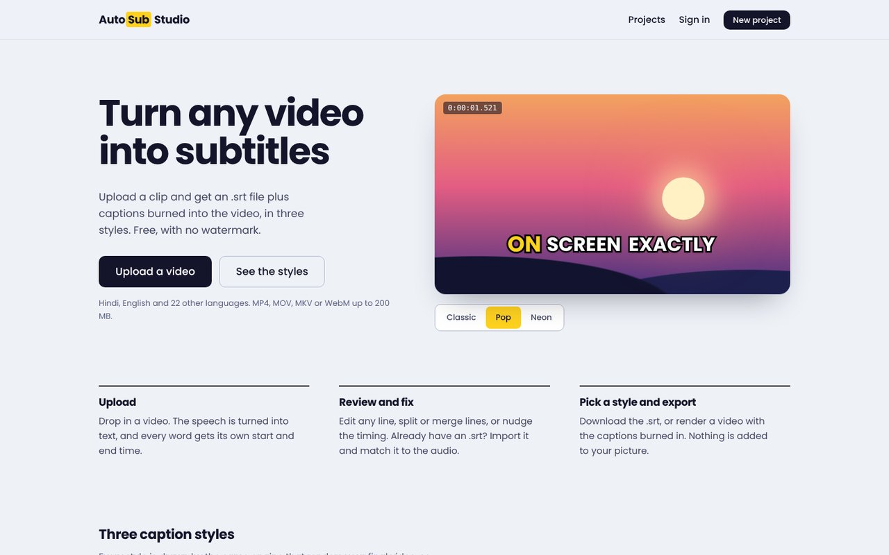
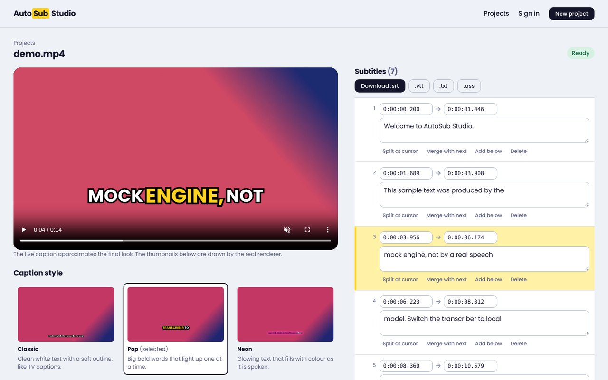
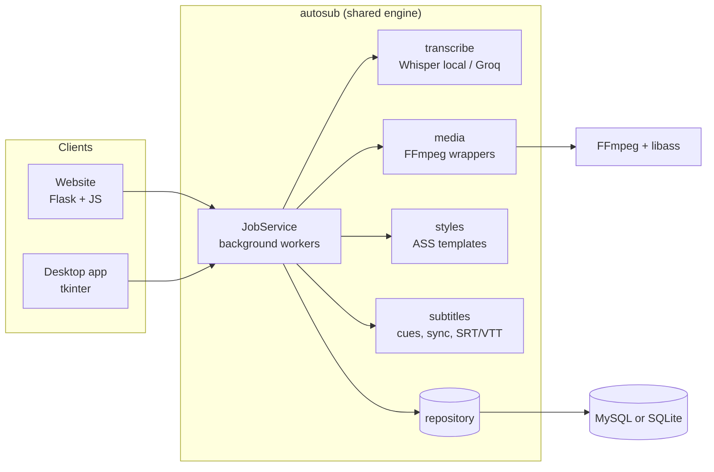
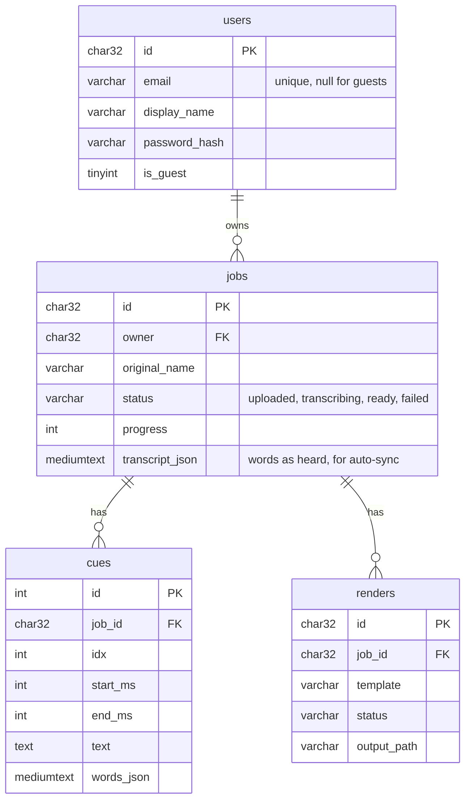

# AutoSub Studio

**Turn any video into subtitles, fix the timing, and burn them in with CapCut-style caption templates.**
A Python website and a desktop app that share one engine, one MySQL database and the same three caption styles.



| | |
|---|---|
| **Website** | Flask + vanilla JavaScript. Upload, edit lines, sync, pick a style, render. Guests can try it without signing up; accounts keep your projects. |
| **Desktop app** | tkinter. Same projects, same engine, works offline with local Whisper. |
| **Engine** | Speech to word-level timestamps, subtitle sync, `.srt` / `.vtt` / `.txt` / `.ass` export, template rendering with FFmpeg. |
| **Database** | MySQL (works on MySQL 8, MariaDB, TiDB Cloud). A SQLite file is used automatically when no MySQL is configured, so the first run needs no setup. |

## Features

**From the project brief**

- **Video to subtitles (.srt).** Whisper (via `faster-whisper`, or Groq's hosted Whisper) transcribes the audio.
- **Timestamp detection.** Every *word* gets its own start and end time, not just every line.
- **Sync subtitles.** Four tools: shift everything, stretch (frame-rate drift such as 23.976 to 25 fps), line up the first and last line, and **match automatically** against what was heard in the video. Import your own `.srt` and sync it too.

**Extras**

- **Caption templates.** After the upload you choose one of three styles, each shown as a preview drawn on a real frame of *your* video:
  - **Classic**: white text with a soft outline, like TV captions.
  - **Pop**: big bold words, the spoken word lights up yellow.
  - **Neon**: glowing text that fills with colour as it is spoken.
- **Render video.** FFmpeg burns the chosen style into the video (MP4, original audio kept).
- **Live caption preview** over the video while you edit (word highlight follows the playback).
- **Line editor**: edit text and times, split at the cursor, merge, add, delete. Autosaves.
- **Exports**: `.srt`, `.vtt`, `.txt`, `.ass` (styled).
- **Accounts**: register, sign in, projects follow you. A visitor's work is kept when they sign up.
- 24 spoken languages plus automatic detection, including Hindi and other Indian languages.



## Quick start on Windows with VS Code

You need: **Python 3.10 or newer** (python.org, tick "Add python.exe to PATH") and **FFmpeg**.

```powershell
# 1. open the project folder in VS Code (File > Open Folder), then open a terminal (Ctrl+`)
py -m venv .venv
.venv\Scripts\Activate.ps1          # if PowerShell refuses: Set-ExecutionPolicy -Scope CurrentUser RemoteSigned
pip install -r requirements.txt

# 2. FFmpeg (once). Close and reopen the terminal afterwards.
winget install Gyan.FFmpeg

# 3. settings
copy .env.example .env

# 4. check everything
python scripts/doctor.py

# 5. run
python run_web.py                   # website at http://127.0.0.1:5000
python run_desktop.py               # desktop app
```

In VS Code you can also press **F5** and choose *Website*, *Desktop app* or *Check my setup* (`.vscode/launch.json`). Select the `.venv` interpreter when VS Code asks.

The first transcription downloads the Whisper `base` model (about 150 MB) and needs internet once. After that it works offline.

macOS / Linux: `python3 -m venv .venv && source .venv/bin/activate`, `brew install ffmpeg` or `sudo apt install ffmpeg`, and for the desktop app `sudo apt install python3-tk`.

### Using MySQL

Without any setup the app stores data in a SQLite file under `data/`. To use MySQL (the project requirement), pick one:

1. **Docker** (easiest, also runs the website): `docker compose up --build`, then open http://localhost:5000.
2. **MySQL on your computer** (MySQL Installer or XAMPP): create the database once,
   ```sql
   CREATE DATABASE autosub CHARACTER SET utf8mb4 COLLATE utf8mb4_unicode_ci;
   ```
   then in `.env` set `DB_HOST=127.0.0.1`, `DB_USER`, `DB_PASSWORD`, `DB_NAME=autosub`, and run `python scripts/init_db.py`.
3. **Free cloud MySQL** (needed for deployment): TiDB Cloud or Aiven. See [docs/DEPLOY.md](docs/DEPLOY.md). Set `DB_SSL=true`.

The tables are created automatically on start-up. The website and the desktop app can use the same database.

## Deploy it online for free

The website is deployed as a Docker service on Render's free plan, with a free cloud MySQL and Groq's free hosted Whisper for the speech recognition (the free server is too small to run Whisper itself). Step by step, including what each free tier limits: **[docs/DEPLOY.md](docs/DEPLOY.md)**.

## How it works



**Upload to subtitles.** The upload is probed with `ffprobe`. A worker thread extracts 16 kHz mono audio, sends it to the speech engine and stores the words with their timestamps. Words are grouped into readable lines (length, pauses, sentence ends). The page polls `/api/p/<id>` for progress.

**Sync.** *Shift*, *stretch* and *anchors* are linear re-timings of every word. *Match automatically* pairs the words of a subtitle file with the words heard in the video using `difflib.SequenceMatcher` (runs of three or more matching words), then fits a straight line through the pairs with an outlier-resistant least-squares fit. The slope is the stretch, the intercept is the shift. If too few words match (wrong language, wrong video) it says so instead of guessing.

**Templates.** Each template builds an ASS subtitle file (word-by-word timing, `\kf` colour fill, glow with `\blur`, pop-in scaling, outlines), sized from the video's height so the same style fits landscape and portrait. The *preview* thumbnails and the *final render* use the same builder, so what you see is what you get. The in-page live caption is CSS that mirrors those rules.

### Database



Foreign keys with `ON DELETE CASCADE`, InnoDB, `utf8mb4` (emoji and every script). The schema is in [`schema/mysql_schema.sql`](schema/mysql_schema.sql) and is applied automatically and safely more than once.

### Project layout

```
autosub/            the engine (no web or GUI code)
  config.py           settings from .env
  db.py               MySQL (PyMySQL) and SQLite behind one small interface
  repository.py       all SQL
  subtitles.py        cues, SRT/VTT/TXT, shift/stretch/auto-sync, split/merge
  styles.py           the three ASS caption templates
  media.py            ffprobe / ffmpeg: audio extraction, previews, burning in
  transcribe.py       faster-whisper, Groq, and a mock engine for tests
  service.py          JobService: orchestrates everything, background workers
  accounts.py         register / sign in / guests
web/                Flask app: pages, JSON API, auth, security, templates, static
desktop/            tkinter app (app.py) and its GUI-free editing rules (logic.py)
schema/             MySQL schema
scripts/            doctor.py, init_db.py, make_gallery.py
tests/              191 automated tests + 3 optional browser tests
docs/               DEPLOY.md, FIRST_RUN_CHECKLIST.md, VIVA_NOTES.md
Dockerfile, docker-compose.yml, render.yaml, .github/workflows/ci.yml
```

### Security notes

Passwords are stored as salted hashes (Werkzeug). All SQL is parameterised. State-changing requests need a CSRF token. A Content-Security-Policy allows scripts only from the site itself (no inline scripts). Other people's projects answer `404`, never `403`, so ids cannot be probed. Logins are rate-limited per address. Uploads are limited by type, size and (optionally) length. Session cookies are `HttpOnly`, `SameSite=Lax`, and `Secure` once `SESSION_COOKIE_SECURE=true`.

## Settings

Everything is configured with environment variables or the `.env` file ([`.env.example`](.env.example) documents all of them).

| Setting | Meaning |
|---|---|
| `DB_HOST`, `DB_PORT`, `DB_USER`, `DB_PASSWORD`, `DB_NAME`, `DB_SSL` | MySQL connection. Empty `DB_HOST` means SQLite. |
| `TRANSCRIBER` | `local` (faster-whisper), `groq` (hosted), `mock` (tests and demos) |
| `WHISPER_MODEL` | `tiny`, `base`, `small` (default), `medium`: accuracy against speed. Use `small` or bigger for Hindi |
| `MAX_UPLOAD_MB`, `MAX_VIDEO_SECONDS`, `RENDER_MAX_HEIGHT`, `JOB_TTL_HOURS` | limits for small free servers |

## Tests

```powershell
pip install -r requirements-dev.txt
pytest                      # 191 tests, about 30 seconds, needs FFmpeg but no speech model and no MySQL
                            # (3 more run when Playwright is installed, see below)
ruff check .                # lint
mypy desktop autosub web scripts
```

The suite covers: subtitle maths and sync accuracy, template rendering on landscape and portrait video, the database layer, accounts, the speech engines (against fakes and a local fake Groq server), the job service, every website route including CSRF, ownership isolation and limits, and the desktop app's behaviour (through a stand-in for tkinter). To run the database tests and the complete upload-to-render flow against a **real MySQL**:

```powershell
$env:TEST_DB_HOST="127.0.0.1"; $env:TEST_DB_USER="root"; $env:TEST_DB_PASSWORD="yourpassword"; $env:TEST_DB_NAME="autosub_test"
pytest tests/test_backends.py -v
```

The 3 optional **browser tests** (`tests/test_browser.py`) start the site and click through it in Chromium: the home-page demo, phone-width layout, and upload, edit, autosave, sync, download and render, failing on any console error or Content-Security-Policy violation. They skip themselves unless you run `pip install playwright` and `playwright install chromium`.

GitHub Actions runs the lint, type check and tests on Python 3.10 and 3.12, the MySQL tests against a MySQL 8 service, and builds the Docker image ([`.github/workflows/ci.yml`](.github/workflows/ci.yml)).

## Known limits

- Rendering and transcription run on the machine that hosts the app. On a free web host videos are kept short (see the limits in `render.yaml`).
- The job queue lives in the server process (one worker process, several threads). It is simple and right for this scale; a larger deployment would use Celery or RQ with a message broker.
- Accuracy is that of Whisper. Heavily accented or noisy audio needs a larger model (`small`, `medium`) and some manual fixing, which is what the editor is for.
- No e-mail verification or password reset yet.

## Resume points

- Built a full-stack video captioning tool (Flask, vanilla JS, tkinter, MySQL, FFmpeg) with a shared engine used by both a website and a desktop app.
- Implemented word-level timestamping with Whisper and an automatic subtitle re-timing algorithm (sequence matching plus robust linear regression; 37 ms worst-case error in the test scenario of a 3.2 s late, 4 % slow file).
- Generated styled, word-by-word animated captions as ASS subtitle files and rendered them with FFmpeg; previews and final output share one renderer.
- Designed a relational schema (users, jobs, cues, renders) with foreign keys and utf8mb4; ran it on MySQL and TiDB Cloud with TLS.
- Deployed with Docker on a free tier using hosted Whisper; wrote 191 tests and a CI pipeline including a real MySQL service container.

## Licence and credits

MIT licence (see [LICENSE](LICENSE); put your own name in it). Poppins font: SIL Open Font License 1.1 (see [assets/fonts/README.txt](assets/fonts/README.txt)). Speech recognition: [faster-whisper](https://github.com/SYSTRAN/faster-whisper) (OpenAI Whisper models) and optionally [Groq](https://groq.com/). Video processing: [FFmpeg](https://ffmpeg.org/).
